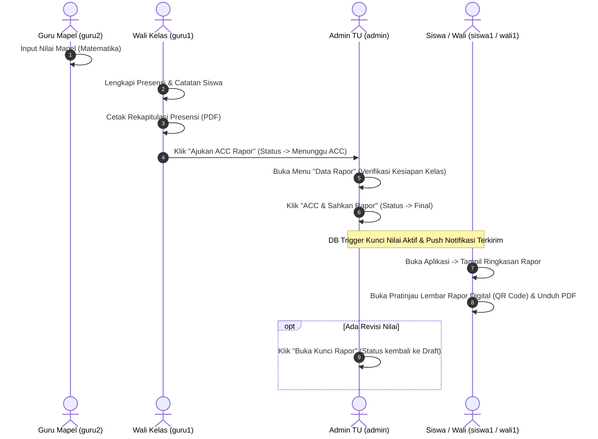

# Panduan Demo Aplikasi & Skenario Uji Coba (Pertemuan 12)
## Sistem E-Raport & Portal Wali Murid MTs Al Fajar Kandat
**Tahap: Review Scrum 4 (Feature Freeze & Versi Beta)**

---

### 1. Daftar Akun Pengujian (Testing Credentials)
Semua akun pengujian di lingkungan pengembangan menggunakan kata sandi bawaan: `123456`

| Peran (Role) | Username | Password | Deskripsi / Skenario Utama |
|---|---|---|---|
| **Admin TU** | `admin` | `123456` | Kelola data master, monitoring data rapor, ACC & finalisasi kelas, buka kunci rapor. |
| **Guru Wali Kelas** | `guru1` | `123456` | Wali Kelas VII-A: Mengisi absensi & catatan siswa, cetak rekap presensi PDF, ajukan ACC. |
| **Guru Mapel** | `guru2` | `123456` | Guru Matematika: Mengisi nilai UTS siswa per kelas. |
| **Siswa** | `siswa1` | `123456` | Siswa Kelas VII-A: Melihat nilai, status kelulusan, dan unduh lembar rapor PDF resmi. |
| **Wali Murid** | `wali1` | `123456` | Orang tua dari `siswa1`: Memantau grafik tren belajar, absensi, catatan wali, dan unduh PDF. |

---

### 2. Skenario Demo Aplikasi Secara Utuh (Feature Freeze Walkthrough)

Alur demonstrasi dirancang berurutan (*end-to-end*) untuk membuktikan bahwa seluruh modul terintegrasi tanpa ada *blocker*:



#### Skenario A: Guru Mapel & Wali Kelas
1. Masuk (*login*) sebagai `guru2`.
2. Buka tab **Nilai** -> Pilih kelas `VII-A` dan mata pelajaran `Matematika`.
3. Masukkan atau sesuaikan nilai beberapa siswa -> Klik **Simpan**.
4. Keluar (*logout*) dan masuk sebagai `guru1` (Wali Kelas VII-A).
5. Pada **Beranda Guru**, perhatikan kartu **Progres Nilai Kelas VII-A**:
   - Ketuk kartu siswa untuk mengisi presensi (Sakit, Izin, Alpa) dan catatan motivasi.
   - Klik tombol **Cetak Rekap Presensi** untuk menampilkan pratinjau dokumen PDF resmi rekapitulasi kehadiran kelas.
   - Klik tombol **Ajukan ACC Rapor** -> Muncul dialog konfirmasi kesiapan nilai -> Konfirmasi pengajuan (status kelas berubah menjadi *Menunggu ACC*).

#### Skenario B: Pengesahan & Penguncian oleh Admin TU
1. Masuk sebagai `admin`.
2. Buka menu samping (*Drawer*) -> Pilih **Data Rapor**.
3. Pilih kelas `VII-A` dan semester `Ganjil`.
4. Perhatikan badge status kelas telah berubah menjadi **Menunggu ACC**.
5. Klik tombol **ACC & Sahkan Rapor**:
   - Sistem mengonfirmasi dan mengubah status seluruh rapor kelas menjadi `final`.
   - Data terkunci secara permanen di database Postgres.
   - Notifikasi FCM otomatis dipicu ke perangkat siswa dan wali murid.

#### Skenario C: Siswa & Wali Murid
1. Masuk sebagai `siswa1` atau `wali1`.
2. Tinjau tampilan **Beranda**:
   - Tampil nama lengkap siswa, nama wali kelas, dan statistik capaian akademik.
   - Tampil grafik sparkline tren perkembangan nilai riil.
   - Tampil rincian absensi dan catatan dari wali kelas.
3. Klik tombol **Unduh Laporan Perkembangan (PDF)** atau tab **Rapor**:
   - Muncul dialog pratinjau lembar rapor resmi madrasah.
   - Memuat kop resmi Kementerian Agama / Yayasan Al Fajar, logo sekolah, tabel nilai dengan SKM & predikat, rekap kehadiran, tanda tangan kepala madrasah, serta verifikasi QR Code.
   - Klik tombol **Unduh** untuk menyimpan berkas PDF ke memori HP.

#### Skenario D: Pembuktian Keamanan & Buka Kunci
1. Coba lakukan perubahan nilai melalui akun guru saat rapor berstatus `final`:
   - Sistem akan menolak karena trigger database `trg_kunci_detnilai` aktif mengunci nilai.
2. Masuk kembali sebagai `admin` -> Menu **Data Rapor** -> Klik **Buka Kunci Rapor**:
   - Status rapor kembali ke `draft` untuk keperluan perbaikan data resmi.

---

### 3. Matriks Skenario Uji (Black-Box Test Cases)

| ID Uji | Fitur / Fungsi yang Diuji | Langkah Pengujian | Hasil yang Diharapkan | Status |
|---|---|---|---|:---:|
| **TC-01** | Otentikasi Multi-Peran | Login berturut-turut dengan akun admin, guru, siswa, wali murid. | Mengarah ke rute beranda masing-masing role tanpa akses lintas role. | **PASS** |
| **TC-02** | Keamanan Password Awal | Login akun baru yang memiliki flag `must_change_password`. | Sistem wajib mengarahkan ke halaman `/ganti-password`. | **PASS** |
| **TC-03** | Rekapitulasi Presensi PDF | Wali kelas menekan "Cetak Rekap Presensi". | Berkas PDF terbentuk dengan kop madrasah, tabel sakit/izin/alpa, & tanda tangan. | **PASS** |
| **TC-04** | Alur Pengajuan ACC | Wali kelas menekan "Ajukan ACC Rapor". | Status rapor berubah menjadi `menunggu_acc` di guru dan admin. | **PASS** |
| **TC-05** | Finalisasi & Pengesahan Rapor | Admin menekan "ACC & Sahkan Rapor". | Status berubah menjadi `final`, mencatat waktu finalisasi & snapshot SKM. | **PASS** |
| **TC-06** | Penguncian Integritas Nilai | Mengubah nilai mata pelajaran setelah status rapor `final`. | Operasi ditolak oleh trigger DB (`trg_kunci_detnilai`). | **PASS** |
| **TC-07** | Buka Kunci Rapor Admin | Admin menekan "Buka Kunci Rapor". | Status rapor kembali ke `draft` dan nilai dapat disesuaikan kembali. | **PASS** |
| **TC-08** | Pratinjau & Cetak Lembar Rapor | Siswa / Wali murid menekan "Unduh Lembar Rapor (PDF)". | Dialog modal menampilkan lembar rapor digital lengkap dengan QR code & unduhan PDF. | **PASS** |
| **TC-09** | Caching Preferensi & Offline | Mengaktifkan filter kelas, menutup aplikasi, lalu membuka kembali. | Preferensi filter kelas & semester tersimpan via SharedPreferences & SQLite. | **PASS** |

---

### 4. Panduan Pembuatan Berkas APK Beta (Rilis Uji Coba)

Untuk kebutuhan instalasi di perangkat HP dosen/penguji pada Pertemuan 12:

```bash
# 1. Bersihkan build cache lama
flutter clean
flutter pub get

# 2. Build APK Rilis Universal (atau per ABI untuk ukuran lebih ringkas)
flutter build apk --release

# Lokasi berkas instalasi:
# build/app/outputs/flutter-apk/app-release.apk
```
